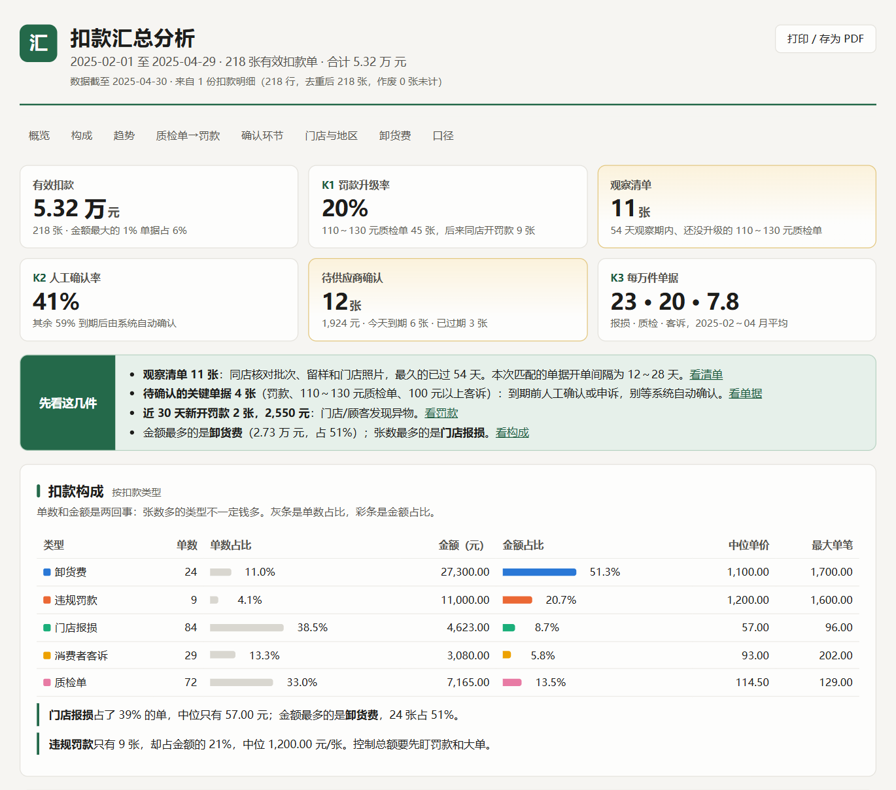
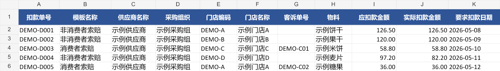
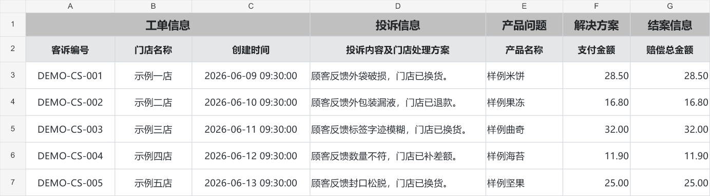
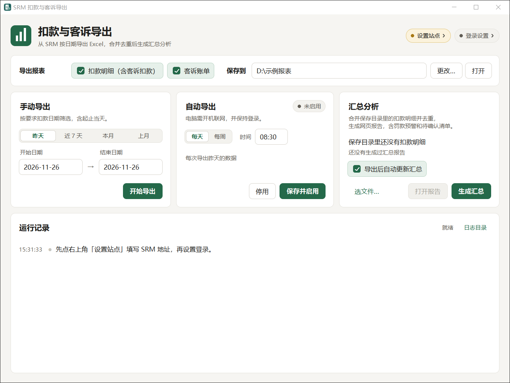

<p align="center">
  
</p>

<h1 align="center">SRM 扣款与客诉导出</h1>

<p align="center">主要面向鸣鸣很忙 SRM，支持按日期导出扣款明细和客诉账单，并生成可离线打开的汇总报告。</p>

<p align="center">Windows 单文件 · 每天或每周自动导出 · 离线汇总 · © 2026 ShepiTT · <a href="#许可与版权">禁止商业用途</a></p>

<p align="center">
  <a href="https://github.com/ShepiTT/srm-report-exporter/releases/latest">下载最新版</a> ·
  <a href="#软件界面">看界面</a> ·
  <a href="#导出示例">看导出示例</a> ·
  <a href="#使用">本地运行</a> ·
  <a href="#隐私">隐私</a>
</p>

<p align="center">
  
</p>

<p align="center"><sub>汇总分析网页示例 · 虚构数据</sub></p>

## 导出示例

下面是两种 Excel 的导出示例。三张预览均使用虚构数据，也可以单独查看[汇总网页大图](docs/export-summary.png)。

### 扣款明细



### 客诉账单



## 软件界面



界面采用圆角卡片布局，支持 Windows 高分屏。右上角的标签显示站点和登录状态，点击即可打开对应设置。

## 使用

1. 从 Releases 下载 `SRMReportExporter.exe`，移到长期使用的目录，然后双击打开。登录使用已安装的 Microsoft Edge。
2. 点击右上角 **站点** 标签，填入管理员提供的 SRM HTTPS 地址。客诉地址用于补充详情。客诉模板编号可留空，程序会识别名称以「消费者索赔」开头的模板。
3. 点击右上角 **登录** 标签。手动导出可在 Edge 完成登录。需要定时运行时，可用当前 Windows 用户加密保存 SRM 凭据。
4. 选择报表和保存目录。手动导出可用「昨天 / 近 7 天 / 本月 / 上月」快速填日期；自动导出选择每天或每周的运行时间。
5. 在 **汇总分析** 点「生成汇总」，完成后会自动在浏览器中打开。勾选「导出后自动更新汇总」后，手动或定时任务成功导出扣款明细时，都会触发汇总更新。

每天导出昨天的数据。每周导出运行日前连续 7 天的数据。定时运行使用 Windows 任务计划，电脑需开机联网且当前 Windows 用户保持登录。

扣款明细包含客诉扣款。客诉账单单独列出这部分数据。程序使用要求扣款日期，缺失时使用创建日期。源系统未提供的客诉字段留空，具体字段见账单中的「抓取说明」。

## 汇总分析

汇总读取保存目录这一层以「扣款明细」开头的 Excel，合并后按扣款单号去重，生成 `扣款汇总分析.html`。这份单文件报告可以离线打开、打印或存为 PDF。用「选文件…」汇总其他位置的文件时，报告保存为 `扣款汇总分析_所选文件.html`，不会覆盖保存目录的报告。

报告内容：

- **概览**：有效扣款合计，罚款升级率（K1），观察清单，人工确认率（K2），待供应商确认的单据，每万件出货的报损、质检和客诉单数（K3）。
- **构成与趋势**：按扣款类型列出张数、金额和中位单价。趋势按创建时间按月、按周或按天显示，跨度超过 120 天按月。
- **质检单 → 罚款**：从罚款的扣款说明里提取门店，对照同店前后 3 天的质检单，给出各金额档的升级率。观察清单列出 110～130 元、开单不超过 54 天、还没对上罚款的质检单。
- **确认环节**：待供应商确认的单据按要求确认日期排序，可筛选关键单据和今天到期的单据。罚款、110～130 元质检单和 100 元以上客诉标为关键单据。有过期单据时显示「已过期」筛选。清单状态以导出时为准，过期单据可能已被系统自动确认。报告另按类型列出人工确认率。
- **门店与地区**：列出扣款最多的门店、各省金额和品牌对比。省份从门店名和仓库名推断。
- **卸货费**：列出各仓卸货费用和单数。配置本机换算费率后，可估算出货件数并计算每万件单据数。

口径：同一扣款单号出现在多个文件时，优先保留「已确认」的版本，其次保留最后修改时间最晚的版本。作废单据不计入。导出区间之间缺的日期会在报告顶部提示。读取过的文件缓存在 `%LOCALAPPDATA%\SrmReportExporterPortable\summary_cache`，文件变化后会重新读取。

## 本机汇总参数

汇总可直接使用。若需要补充品牌、仓库归属、卸货费按件换算或预警起始日期，可在 `%LOCALAPPDATA%\SrmReportExporterPortable\summary_options.json` 中填写以下可选项目。

```json
{
  "brand_prefixes": {},
  "warehouse_org_locations": {},
  "yuan_per_piece": null,
  "chain_start": null
}
```

`brand_prefixes` 将门店名的前缀对应到显示品牌，`warehouse_org_locations` 将组织编码前缀对应到 `["地点", "省份"]`。`yuan_per_piece` 填每件人民币金额，`chain_start` 用 `YYYY-MM-DD`。本机参数与报表会留在当前电脑。

## 隐私

程序通过已授权的账号读取设置的站点。站点设置和加密的登录信息保存在本机 `%LOCALAPPDATA%\SrmReportExporterPortable`，Excel 和汇总网页也在本机生成和保存。

## 许可与版权

© 2026 ShepiTT。本项目的自有代码和程序采用 [PolyForm Noncommercial 1.0.0](LICENSE)，仅授权非商业用途。商业使用须事先获得版权所有者许可。

再分发时请随附许可证和[版权声明](NOTICE)。第三方组件适用各自的许可，详见发布页随附的 `THIRD_PARTY_NOTICES.zip`。

## 构建

使用 Windows x64、Python 3.13 和 Microsoft Edge。

```powershell
python -m venv .venv
.\.venv\Scripts\python.exe -m pip install -r requirements.txt
.\build.ps1 -Python .\.venv\Scripts\python.exe
```

构建产物位于 `dist\SRMReportExporter.exe`。
